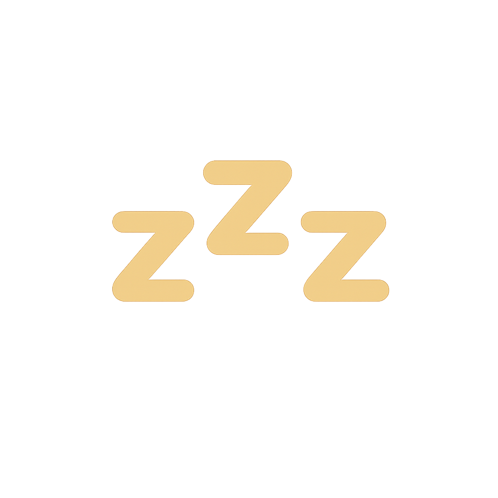

  

  # Naps Theme

  A cozy, eye-friendly dark theme for VSCode. So relaxing you might fall asleep 😴

  
  
  
  

## Themes

### Naps

The original relaxed theme with classic colors.

### Naps Dusk Gold

A warm variant with swapped color rules and darker background.

- Keywords (const, if, return): Orange
- Constants (true, false): Purple
- Strings: Gold
- Darker background for better contrast

## Installation

Available on both the [VS Code Marketplace](https://marketplace.visualstudio.com/items?itemName=kimmojae.naps-theme) and [Open VSX](https://open-vsx.org/extension/kimmojae/naps-theme) (Cursor, VSCodium, Windsurf, etc.).

1. Open **Extensions** in VSCode / Cursor (`Cmd+Shift+X`)
2. Search for `Naps Theme`
3. Click **Install**
4. `Cmd+K Cmd+T` → Select **Naps** or **Naps Dusk Gold**

## Credits

Based on [Make Apps Theme](https://marketplace.visualstudio.com/items?itemName=dannyconnell.make-apps-theme) by [Danny Connell](https://github.com/dannyconnell).

Original theme lineage:

- [Hybrid Next Theme](https://marketplace.visualstudio.com/items?itemName=wyze.theme-hybrid-next) by [Neil Kistner](https://github.com/wyze)
- [Hybrid Next Theme for Atom](https://github.com/kaicataldo/hybrid-next-syntax) by [Kai Cataldo](https://github.com/kaicataldo)
